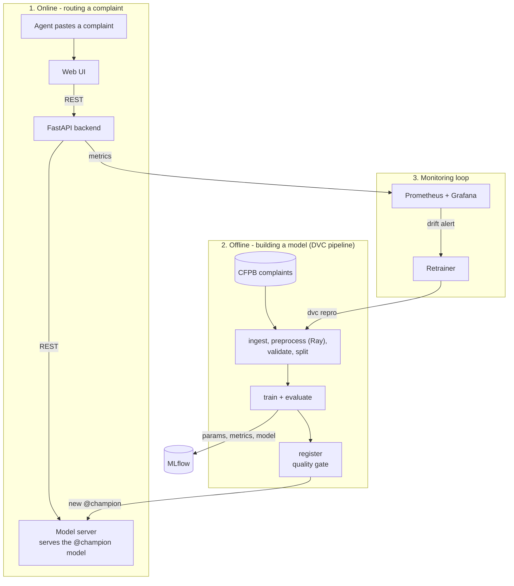

# High-Level Design - Financial Complaint Router

## 1. Problem and success metrics

Banks receive large volumes of free-text complaints that are triaged by hand: slow, inconsistent, and risky for complaint types with regulatory response deadlines. The system reads a complaint and returns:

1. the **routing category** and owning team (9 categories),
2. a **priority flag** for complaints that need faster handling,
3. a **confidence score**, an explanation, and **similar past complaints**.

| Metric (test set) | Target (acceptance gate in `params.yaml`) | Achieved (champion v2, SGD, real CFPB data) |
|---|---|---|
| Routing macro-F1 (9 classes) | ≥ 0.70 | **0.80** (accuracy 0.82; 0.90 when confident) |
| Urgent-complaint recall | ≥ 0.65 | **0.74** |
| Share of complaints flagged urgent | ≤ 35 % | **31.2 %** (true urgent rate 17.9 %) |
| Single-request latency | < 1 s p95 | **about 0.2 s** end to end (28 ms of model time) |
| Preprocessing throughput (Ray, 2 CPUs) | - | **~10,000 rows/s** (650k rows in 64 s) |

### High-level diagram

The system has three parts: **online** routing of one complaint, **offline** building of a model, and a **monitoring loop** that connects them.

## 2. Data

* **Source:** CFPB Consumer Complaint Database (public, US). In 2025 the live CFPB export stopped publishing the narrative text, so the pipeline reads the Apache-2.0 parquet mirror on HuggingFace (`davidheineman/consumer-finance-complaints-large`, 7M rows up to Nov 2024). The `ingest.source` parameter also accepts a local file or the bundled sample.
* **Labels:** the raw `product` field uses about 20 overlapping names (taxonomy changes in 2017 and 2022). They are consolidated into 9 routing categories (`categories.py`).
* **Priority label (weak supervision):** CFPB has no urgency field. A complaint is labelled urgent when the consumer-selected *issue/sub-issue* describes fraud, identity theft, unauthorized transactions, foreclosure/repossession, inability to pay, threats or abusive collection. These are the situations where regulators expect expedited handling.
* **Known biases:** the data is US-only and self-selected (people who complain to a regulator). Credit reporting makes up ~44 % of complaints, so classes are capped (`split.max_per_class`). Template-written credit disputes are common. PII is already redacted by CFPB (`XXXX`), and the pipeline additionally masks e-mails, phone numbers and long digit runs.

## 3. Key design decisions

| Decision | Choice | Rationale | Alternatives considered |
|---|---|---|---|
| Model family | TF-IDF (1-2 grams) + linear classifiers (LogReg / SGD / ComplementNB selectable) | Trains in about 1 min on a laptop VM with no GPU. A strong baseline for topic classification. **Directly explainable** (term × weight), which matters in a regulated domain. Fast CPU inference (~1 ms of model time). | Fine-tuned BERT: about 3-5 points more F1 but needs a GPU, makes VM latency worse and is opaque. Rejected for this AIOps-focused scope. |
| Priority | Separate balanced LogReg; threshold tuned on validation to a target recall; plus a transparent rule that always escalates severe situations (foreclosure, repossession, garnishment, eviction, being sued) | Missing an urgent case costs more than an extra review, so tuning is recall-oriented. The gate caps the flag rate so the flag stays meaningful. Softer words such as "fraud" (in 15 % of complaints, 25 % precision) are only *shown* as signals. | Pure keyword rules (low precision); a single multi-task model (less transparent). |
| Similar complaints | Cosine similarity in the same TF-IDF space over a 15k-complaint index stored inside the model artifact | No extra service or vector DB. Versioned together with the model, so it is always consistent with it. | FAISS / vector DB: unnecessary at this scale. |
| Data engineering | **Ray Data** `map_batches` over parquet blocks | Required by the brief (Ray/Spark/K8s). Scales from 2 cores to a cluster without code change. The same pure function also runs in pandas (fallback, tests) and at inference, so there is no train/serve skew. | Spark: heavier JVM footprint on a VM. |
| Pipeline / CI | **DVC DAG** (`dvc.yaml`) with `ci_tests` as the first stage; git pre-push hook runs lint + tests | `dvc repro` re-runs only what changed (code, data or params). Unit tests gate training. Data and models are versioned in a local DVC remote. Cloud CI is not allowed. | Airflow: needs its own scheduler/DB, which is overkill here. |
| Experiment tracking | MLflow: autolog (nested runs per estimator) **plus** explicit params, metrics, tags (git commit, data MD5, trigger, versions) and artifacts (confusion matrix, top terms, reference stats) | Every run is reproducible from *git commit + MLflow run id + DVC lock*. | - |
| Serving | `mlflow models serve` (pyfunc) behind a FastAPI backend | MLflow handles model "APIfication". FastAPI owns the public contract, validation, metrics and security. The UI never talks to the model directly (loose coupling). | Loading the model inside FastAPI: couples model deployment to API deployment. |
| Deployment / rollback | Registry aliases + model-server supervisor | Promotion and rollback only move an alias. No image rebuild, no downtime of the API. | Rebuilding images per model: slow, mixes code and model lifecycles. |
| Monitoring | Prometheus + Grafana + Alertmanager | Latency, errors, prediction mix, confidence, drift, pipeline durations/throughput, host resources. Drift alerts drive retraining. | - |
| Drift detection | PSI of predicted-category mix, PSI of text length, rise in out-of-vocabulary rate, over a rolling window of 200 requests | Label-free (true labels arrive late in production). Cheap, interpretable. | KS tests on embeddings: costlier, less interpretable. |
| Security | Feedback encrypted at rest (Fernet / AES); admin token for retraining; complaint text never logged (SHA-256 fingerprint only); PII masking; non-root containers; CORS allow-list | Complaint text is personal financial data. | - |
| UI | Static HTML/JS (no build step) | Easy to inspect and fast. Configurable API base URL keeps the UI fully decoupled from the backend. | React: a build toolchain without user benefit here. |

### Model comparison

All three model types were trained on the same data split (`make compare`, logged in MLflow and DVC experiments). The register stage picked the winner automatically.

| Model (`train.model_type`) | Test accuracy | Test macro-F1 | Registry result |
|---|---|---|---|
| Logistic regression (`logreg`) | 0.812 | 0.787 | v1, first champion |
| **SGD, modified Huber loss (`sgd`)** | **0.821** | **0.801** | **v2, promoted to champion** |
| Complement Naive Bayes (`cnb`) | 0.788 | 0.739 | v3, rejected (worse than champion) |

SGD is now the default in `params.yaml`. Priority recall is the same for all three (0.74) because the priority model does not depend on `model_type`.

## 4. Software design paradigm

* **Object-oriented** core: `ComplaintRouter` (estimator with fit/predict/save/load), `ComplaintRouterPyfunc` (adapter), `ModelServerClient`, `RegistryClient`, `DriftMonitor`, `PipelineService`, `AppState`.
* **Functional** data layer: `text_cleaning.py`, `drift.py`, `categories.py`, `register.decide()` are pure functions. This makes them trivially unit-testable and safe to ship to Ray workers.
* **Dependency injection:** `create_app(settings, model_client, registry)` allows the API to be tested without any running service.

## 5. Lifecycle mapping (guideline II A-E)

| Stage | Where |
|---|---|
| A. Problem, data collection, validation | this document; `ingest.py`; `validate.py` (quality gate); EDA numbers in `reports/preprocess.json` |
| B. Preprocessing & features | `text_cleaning.py`, `preprocess.py` (Ray), TF-IDF in `router_model.py`; feature importance logged as `explainability/top_terms_per_class.json` |
| C. Training & evaluation | `train.py`, `evaluate.py`, `dvc exp run -S train.model_type=sgd` for experiments; MLflow comparison UI |
| D. Deployment | MLflow registry, model-server supervisor, Docker Compose, rollback script |
| E. Monitoring & maintenance | Prometheus/Grafana, drift monitor, alert rules, retrainer, encrypted feedback loop |

## 6. Limitations and future work

* Weak priority labels limit priority precision. Agent feedback (`correct_priority`) gradually adds true labels.
* Single-node deployment. The compose file is Swarm-compatible, and Ray can point at a multi-node cluster via `ray.init(address=...)`.
* A transformer model could be added as another `model_type`. The pipeline and serving stay unchanged.
