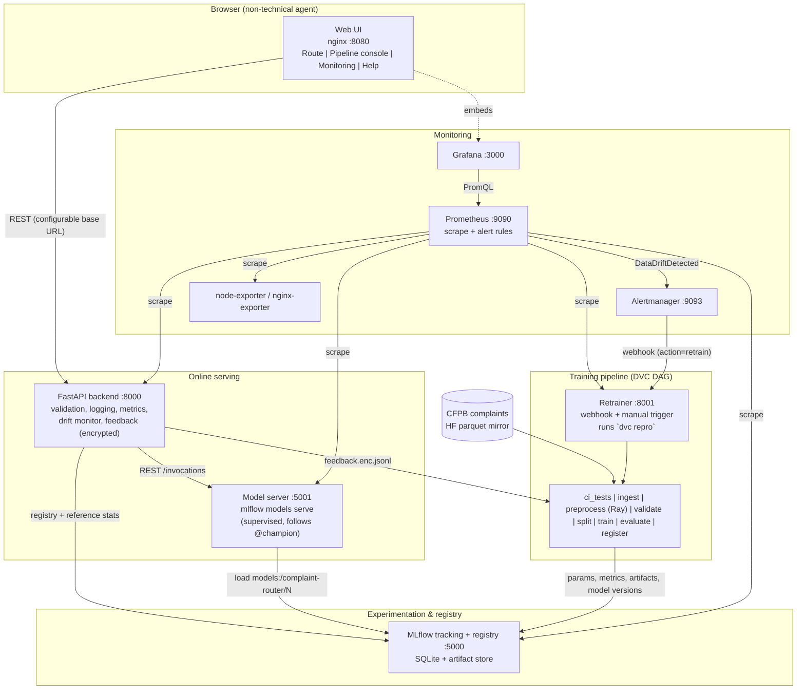

# Architecture - Financial Complaint Router

## 1. System diagram

## 2. Blocks

| Block | Technology | Responsibility | Talks to |
|---|---|---|---|
| **Web UI** | HTML/CSS/vanilla JS on nginx 1.27 | The screens a non-technical agent uses: paste a complaint and see the result, the pipeline console (DAG, stage runs, failures, registry, retraining), monitoring (embedded Grafana) and help. Holds no business logic. | Backend only, via REST. The base URL is injected at container start (`config.js`). |
| **Backend** | FastAPI, pydantic, httpx, prometheus-client | Public REST API. Validates input, calls the model server, enriches and logs decisions (text hashed, never logged raw), exports Prometheus metrics, runs the drift monitor and stores encrypted agent feedback. | Model server (REST), MLflow (registry read), retrainer (REST), workspace reports (read-only). |
| **Model server** | `mlflow models serve` + supervisor | Serves the pyfunc model. The supervisor polls the registry alias `@champion` and redeploys when it moves. This gives continuous deployment and one-command rollback. | MLflow (download model). |
| **MLflow** | MLflow 2.17 server, SQLite backend, proxied artifacts | Experiment tracking (params, metrics, artifacts, tags), model registry with aliases `@champion` / `@challenger`. | Pipeline, backend, model server. |
| **DVC pipeline** | DVC 3, Ray Data, scikit-learn | Reproducible DAG from raw data to registered model. Only stages whose inputs changed are re-run. | MLflow, local DVC remote. |
| **Retrainer** | FastAPI + subprocess `dvc repro` | Closes the loop: an Alertmanager webhook or a manual trigger starts the pipeline. Single-flight lock plus cool-down. | Workspace (git/DVC repo), MLflow. |
| **Prometheus** | Prometheus 2.55 | Scrapes all services every 10 s. Evaluates alert rules (drift, latency, errors, model down, failed retrain, host memory). | All exporters, Alertmanager. |
| **Alertmanager** | Alertmanager 0.27 | Routes `action=retrain` alerts to the retrainer webhook. Other alerts are shown in its UI (external notification services are out of scope: no cloud). | Retrainer. |
| **Grafana** | Grafana 11.3 | Near-real-time dashboard (provisioned as code from `scripts/build_grafana_dashboard.py`). Anonymous read-only access so it can be embedded in the UI. | Prometheus. |
| **Exporters** | node-exporter, nginx-prometheus-exporter | VM CPU/memory/disk and frontend request metrics. | Prometheus. |

## 3. Main flows

**Routing a complaint (online):** UI `POST /api/v1/predict` → backend validates the input and times the request → model server `POST /invocations` → ComplaintRouter (TF-IDF → linear classifier + priority model + explanation + similar cases) → backend adds `prediction_id` and `model_version`, updates metrics and the drift window → UI renders the result.

**Training (offline, reproducible):** `dvc repro` → `ci_tests` (unit tests must pass) → `ingest` → `preprocess` (Ray) → `validate` (quality gate) → `split` → `train` (MLflow run + pyfunc model) → `evaluate` (test metrics, drift reference) → `register` (registry version, acceptance gate, `@champion` alias).

**Continuous deployment / rollback:** the register stage moves `@champion` → the supervisor sees a new version within 20 s → it restarts `mlflow models serve` on that version. `make rollback VERSION=N` moves the alias back.

**Drift → retraining loop:** the backend computes drift over the last 200 requests → gauge `complaint_router_drift_detected = 1` → Prometheus rule `DataDriftDetected` (for 1 min) → Alertmanager → `POST retrainer:8001/webhook/alertmanager` → `dvc repro --force` (includes decrypted agent feedback) → gated promotion → automatic redeploy → the backend loads the new reference statistics and resets the drift window.

## 4. Deployment view

All services are containers in one Docker Compose project (`docker-compose.yml`) on a single Ubuntu VM. Data lives in named volumes (`mlflow-data`, `prometheus-data`, `grafana-data`) and in the bind-mounted git/DVC workspace. The same images run in development and production (environment parity). The compose file also works with `docker stack deploy` on Swarm. No cloud services are used: the DVC remote is a local directory and alerting stays inside the stack.
